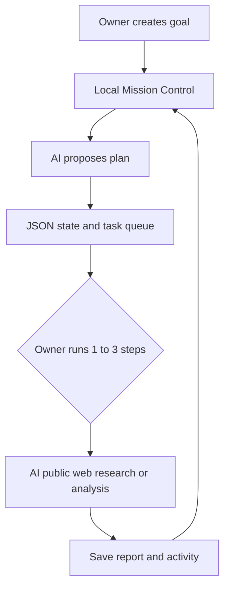

# ARCHER architecture — V0.1 to V1

## Principles

1. **Mission-first, not chat-first.** Goals have an explicit plan, bounded steps, saved reports, and a history of actual work.
2. **Least privilege.** V0.1 tools are public web search and analysis only; no file-system shell, payments, production deploys, or messaging.
3. **Human approval for consequential actions.** No external communications, purchase, or code deployment without an approval gate.
4. **Observe real tool results.** Never claim an action happened unless its tool returned success and it was recorded.
5. **Limit costs and retries.** Prototype: 3 tasks max per click or opt-in background authorization. No automatic task retries. V1: enforce cost/token budget, task runtime limits, retries, deduplication, and operator override.
6. **Keep data separate from employer systems.** Do not access SmartGridSuite, PartsPortal, or employer networks without explicit permission and an isolated legal integration.

## V0.1 flow

## V0.2 opt-in local background execution

After the owner generates a plan, the owner may explicitly authorize at most 3 pending research/analysis attempts through Mission Control. A BackgroundService claims and executes them **one at a time** while Archer is running, saving reports and activity to the existing JSON state.

- Authorization state is persisted but **cleared at every restart** to avoid unexpected paid API calls.
- A failed task stops the worker for that mission; failures require a manual retry.
- Clicking Pause prevents subsequent tasks, but does not cancel a call already underway.
- Backend status checks avoid concurrent automatic and manual runs on the same mission.
- This is a prototype worker, not a robust durable hosted queue, and not a hard API spending cap.

## V1 target architecture

- **Web UI:** React/Blazor or existing lightweight browser UI.
- **API:** ASP.NET Core.
- **Persistence:** SQLite for one owner or PostgreSQL for hosted/multiple workers.
- **Jobs:** Durable queue with lock, heartbeat, deadline, retry policy, cost budget, and activity stream.
- **AI:** Model adapter supporting multiple providers with tool call validation and source transparency.
- **Skills:** Research, code assistance, project analytics. Each skill runs in a constrained environment.
- **Comms:** Twilio SMS/voice, with quiet hours, emergency categories, opt-in, logs, and owner phone allowlist.
- **Security:** Auth before network exposure, encrypted credentials, per-tool privileges, outbound domains allowlist, and action approvals.

## Initial acceptance criteria

- Can create and reopen a mission without data loss after app restart.
- Generate plan with 3–5 tasks when API key/model are configured.
- Can run bounded steps and read actual stored deliverables, including when a later task fails.
- Failure does not count as success; failed step requires explicit retry.
- No remote endpoints exposed; the app binds only to localhost.
- No AI-initiated email, phone calls, spending, or code execution without implementing a separate permission boundary.

## Known prototype limitations

- No unit/integration tests yet, and .NET build not validated in authoring environment.
- Manual runs still use the HTTP request; an opt-in BackgroundService runs up to three research/analysis attempts while the local process is alive. There is still no durable, always-on hosted job scheduler.
- No user authentication (therefore localhost only).
- Local JSON serialization assumes one server process; never run multiple instances against the same data folder.
- Chat memory is a recent conversation window, not semantic retrieval or long-term knowledge indexing.
- Research responses may contain citations as plain text; they have not been independently audited.
- No hard budget enforcement; task count and output tokens only provide partial usage limits.
